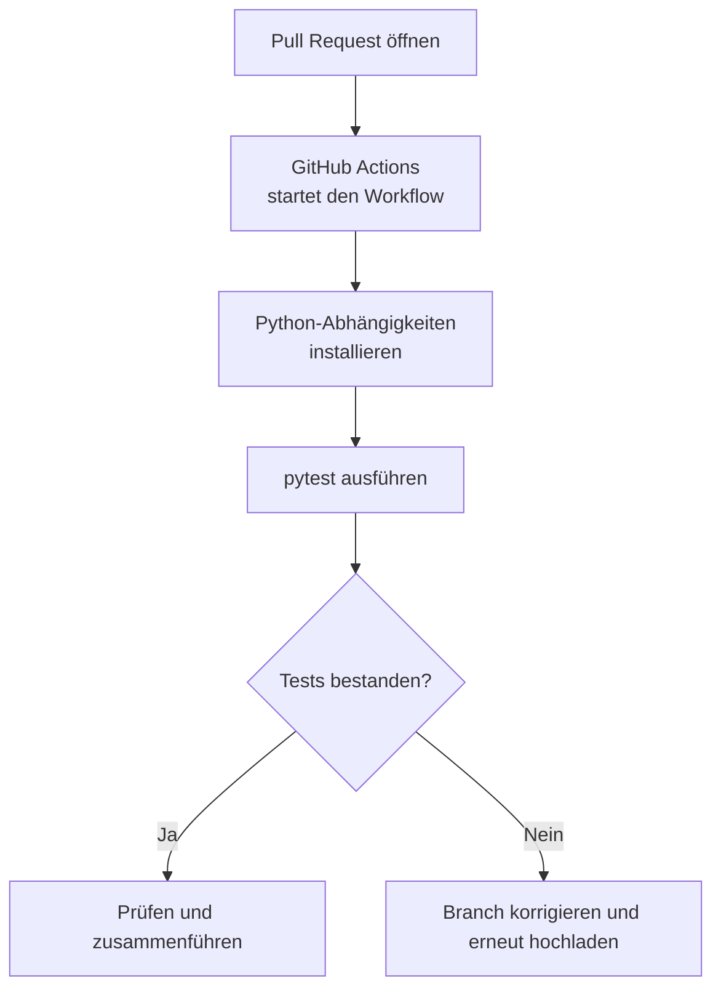
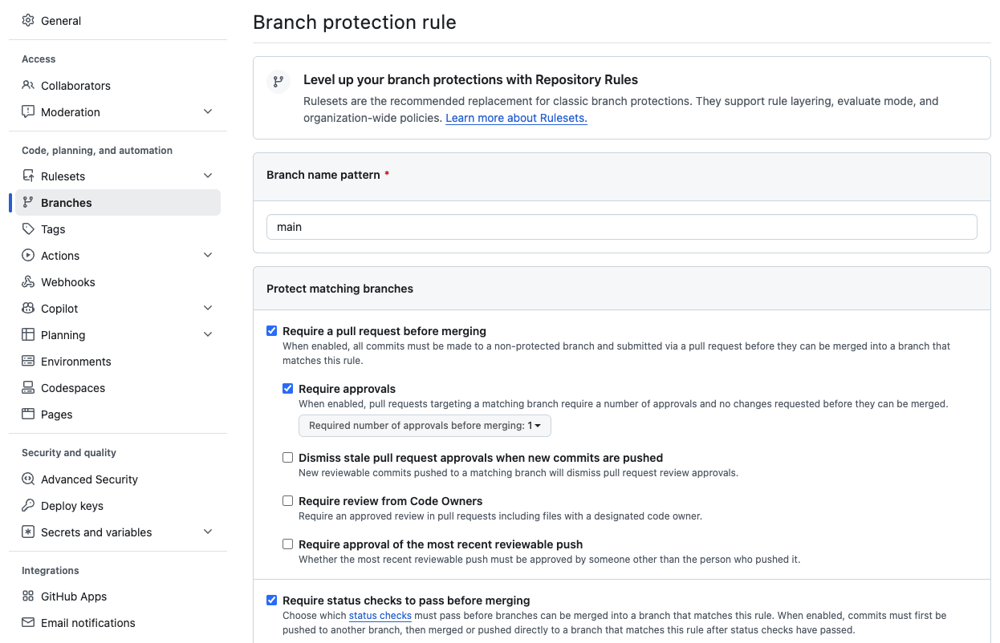
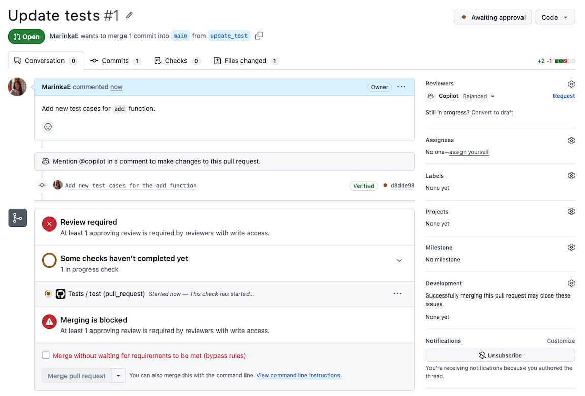

# GitHub Actions

GitHub Actions ist die in GitHub eingebaute Automatisierungsplattform. In ML-Projekten kannst du damit vor dem Merge von Code Tests ausführen, die Formatierung prüfen, Container bauen, versionierte Daten herunterladen oder Jobs für das Modelltraining auslösen.

In dieser ersten Lektion erstellst du einen kleinen Workflow für Pull Requests. Das Beispiel ist bewusst einfach: Fang mit einer Python-Funktion und einem Check mit pytest an und mach diesen Check dann zur Pflicht, bevor Code in `main` zusammengeführt werden kann.

## Workflow



## Test-Workflow erstellen

1. Erstell auf GitHub für diese Aufgabe ein **neues, leeres Repository** und mach es **öffentlich**. Es wird nur in Lektion 1 genutzt. Halte es getrennt von dem ML-Repository, das du aus diesem Template erstellt hast und das in den Lektionen 2 bis 5 genutzt wird.

2. Klon das Repository, wechsle mit `cd` hinein und richte es als uv-Projekt mit Python 3.13 und pytest ein:

   ```bash
   echo "3.13" > .python-version
   uv init --bare
   uv add --dev pytest
   ```

   Das erstellt `pyproject.toml` und `uv.lock`. Nimm beide zusammen mit `.python-version` in einen Commit auf, damit GitHub Actions genau dieselbe Umgebung installiert.

3. Erstell `src/calculator.py`:

   ```python
   def add(a, b):
       return a + b
   ```

4. Erstell `tests/test_calculator.py`:

   ```python
   from src.calculator import add


   def test_add():
       assert add(1, 2) == 3
       assert add(-2, 2) == 0
       assert add(0, 0) == 0
   ```

5. Erstell `.github/workflows/test.yaml`:

   ```yaml
   name: Tests

   on:
     pull_request:
       branches:
         - main

   permissions:
     contents: read

   jobs:
     test:
       runs-on: ubuntu-latest
       timeout-minutes: 10
       steps:
         - uses: actions/checkout@v6

         - name: Set up uv
           uses: astral-sh/setup-uv@v7
           with:
             version: "0.13.5"

         - name: Install dependencies
           run: uv sync --locked

         - name: Run tests
           run: uv run python -m pytest
   ```

6. Lade diese Startdateien nach `main` hoch.

7. Geh zu **Settings > Branches > Add classic branch protection rule** und leg Folgendes fest:

   - Branch name pattern: `main`
   - Require a pull request before merging: **Aktivieren**
   - Require approvals: **Aktivieren**
   - Require status checks to pass before merging: **Aktivieren**

   Klick dann auf **Create**.



8. Erstell einen neuen Branch, ändere den Taschenrechner oder den Test, nimm die Änderung in einen Commit auf und öffne einen Pull Request auf `main`. Du solltest sehen, dass der Workflow automatisch startet.



## Ergebnis interpretieren

Der Check im Pull Request ist ein Feedback-Gate. Ein bestandener Check bedeutet, dass das Repository die Testumgebung neu erstellen und die Testsuite von Grund auf ausführen kann. Ein fehlgeschlagener Check bedeutet, dass der Branch noch einen Commit braucht, bevor er bereit für den Merge ist.

Der Start-Workflow fordert nur `contents: read` an, weil er nur das Repository auschecken und Tests ausführen muss. Später fordert der CML-Workflow Schreibrechte an, weil er einen Kommentar im Pull Request veröffentlichen muss.

`uv sync --locked` liest `.python-version`, installiert Python 3.13 und installiert genau die Versionen, die in `uv.lock` fixiert sind. Das Flag `--locked` lässt den Job fehlschlagen, wenn `uv.lock` nicht mehr zu `pyproject.toml` passt. So zeigt sich eine vergessene Aktualisierung der Lock-Datei im Pull Request, statt dass sich Versionen unbemerkt ändern.

Die Einstellung `timeout-minutes` ist eine kleine Schutzmaßnahme: Wenn die Installation der Abhängigkeiten oder ein Testdurchlauf hängen bleibt, stoppt GitHub den Job, statt ihn laufen zu lassen, bis das Limit des Repositorys erreicht ist.

In einem größeren ML-Repo kann dasselbe Muster Datenvalidierung, Linting, Smoke-Tests für das Modell oder Trainingsjobs ausführen. Spätere Lektionen erweitern diesen Workflow um DVC und CML.

## Aufgabe

- Füg eine Funktion `subtract(a, b)` und einen passenden Test mit pytest hinzu.
- Lade den Branch hoch und prüf, ob der Workflow erneut läuft.
- Mach absichtlich eine Assertion kaputt, beobachte den Fehlschlag und behebe ihn dann mit einem neuen Commit.

## Zum ML-Repository zurückkehren

Die Lektionen 2 bis 5 laufen in dem ML-Repository, das du aus diesem Template erstellt hast, nicht im Taschenrechner-Repository. Bevor du weitermachst, wechsle wieder in dieses Repository:

```bash
cd <path-to-ml-repository>
```
