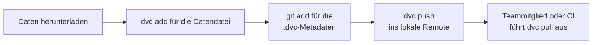

# Einführung in Data Version Control (DVC)

[DVC](https://dvc.org/) überträgt die Workflows der Versionsverwaltung auf Daten und Modellartefakte. Während Git den Code und kleine Metadatendateien versioniert, speichert DVC große Dateien in einem Cache oder einem Remote-Speicher.

In dieser Lektion versionierst du einen Parquet-Datensatz mit DVC und lädst die eigentliche Datendatei in ein lokales DVC-Remote-Verzeichnis hoch.

## Warum DVC hilft

Machine-Learning-Projekte ändern sich in zwei Dimensionen: Der Code ändert sich und die Daten ändern sich. Git kommt gut mit Code zurecht, aber große Datendateien gehören nicht in den Git-Verlauf. DVC legt eine kleine `.dvc`-Metadatendatei in Git ab, damit ein Teammitglied oder ein CI-Workflow später die exakte Version der Daten wiederherstellen kann.

Mit DVC kannst du:

- große Datendateien versionieren, ohne sie per Commit in Git aufzunehmen,
- dieselbe Version des Datensatzes auf einem anderen Rechner wiederherstellen,
- Metriken über Experimente hinweg vergleichen,
- reproduzierbare Pipelines für die Datenverarbeitung definieren.

## Workflow für die Datenversionierung



## Taxi-Datensatz versionieren

Lade die Green-Taxi-Daten von Januar 2025 herunter:

```bash
curl -L --fail -o data/green_tripdata_2025-01.parquet \
  https://d37ci6vzurychx.cloudfront.net/trip-data/green_tripdata_2025-01.parquet
```

Initialisiere DVC im Repository:

```bash
uv run dvc init
```

Füg die lokale Datendatei zu DVC hinzu:

```bash
uv run dvc add ./data/green_tripdata_2025-01.parquet
```

DVC erstellt eine kleine Metadatendatei namens `data/green_tripdata_2025-01.parquet.dvc`. Füg diese Datei zu Git hinzu:

```bash
git add .dvc/.gitignore .dvc/config .dvcignore data/green_tripdata_2025-01.parquet.dvc
git commit -m "Track taxi data with DVC"
```

Die Parquet-Datei selbst bleibt außerhalb von Git. Die `.dvc`-Datei hält genug Informationen fest, damit DVC die Datei über seinen Cache oder sein Remote finden und prüfen kann.

## Lokales Remote hinzufügen

Erstell außerhalb des Repositorys ein Verzeichnis, das als DVC-Remote dient:

```bash
mkdir -p ../dvc-local-remote
```

Füg dieses Verzeichnis als Standard-Remote von DVC hinzu:

```bash
uv run dvc remote add -d localremote ../dvc-local-remote
```

Nimm die gemeinsame Remote-Konfiguration in einen Commit auf:

```bash
git add .dvc/config
git commit -m "Add local DVC remote"
```

Lade die Datendatei ins lokale Remote hoch:

```bash
uv run dvc push
```

Jetzt kann ein anderes Teammitglied oder ein Workflow in GitHub Actions das Repository klonen und die Daten so wiederherstellen:

```bash
uv run dvc pull
```

Weil das ein lokales Setup ist, ist das Remote nur ein weiteres Verzeichnis auf deinem Rechner. Bei Teamprojekten kannst du es später durch einen gemeinsamen Speicher ersetzen, sobald der DVC-Workflow klar ist.

Wenn du das Repository in einen anderen Ordner auf demselben Rechner klonst, kann `uv run dvc pull` die Parquet-Datei wiederherstellen, solange der konfigurierte lokale Remote-Pfad noch auf das Verzeichnis zeigt, in dem du `uv run dvc push` ausgeführt hast.

| Datei oder Verzeichnis | Per Commit in Git? | Warum |
| --- | --- | --- |
| `data/green_tripdata_2025-01.parquet` | Nein | Das ist die große Rohdatendatei. |
| `data/green_tripdata_2025-01.parquet.dvc` | Ja | Das ist der kleine Metadaten-Pointer, mit dem DVC die Daten wiederherstellt. |
| `.dvc/config` | Ja | Sie speichert den gemeinsamen lokalen Remote-Pfad für die Aufgabe. |
| `../dvc-local-remote/` | Nein | Das ist der lokale Speicherbereich für die DVC-Objekte. |

## Metadaten untersuchen

Öffne `data/green_tripdata_2025-01.parquet.dvc`, nachdem du `uv run dvc add` ausgeführt hast. Beachte, dass Git Metadaten wie den Dateipfad, den Hash und die Größe versioniert, nicht den vollständigen Inhalt der Parquet-Datei. Das ist die zentrale Übergabe zwischen Git und DVC.

## Pipelines

DVC kann auch Datenpipelines für das Filtern, das Feature Engineering und das Modelltraining definieren. Eine Pipeline hält Befehle, Abhängigkeiten, Ausgaben und Metriken fest, damit sich die Arbeit reproduzieren lässt. Dieses Repository nutzt nur die Datenversionierung von DVC, aber der nächste naheliegende Schritt ist der [Leitfaden zu Datenpipelines in DVC](https://dvc.org/doc/start/data-pipelines).

## Aufgabe

- Untersuche die erzeugte `.dvc`-Datei und erklär, welche Felder Git versioniert.
- Führ `uv run dvc status` vor und nach einer Änderung an der lokalen Parquet-Datei aus.
- Untersuche `../dvc-local-remote` nach `uv run dvc push` und prüf, ob DVC das Datenobjekt dort gespeichert hat.
- Klon dein ML-Repository in einen separaten Ordner, wechsle in sein Stammverzeichnis, konfiguriere denselben lokalen Remote-Pfad und teste `uv run dvc pull`.
