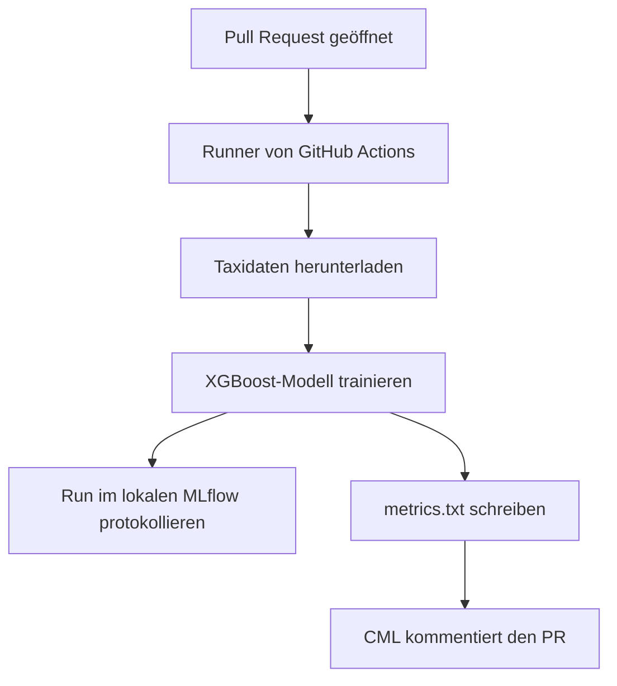

# CI/CD-Workflow mit CML

Continuous Integration fragt: „Kann diese Änderung sicher zusammengeführt werden?“. Im Machine Learning umfasst diese Frage Code, Datenzugriff, Trainingsverhalten und Metriken. Mit [CML](https://cml.dev/) kann ein Workflow in GitHub Actions Modellergebnisse direkt in einem Pull Request veröffentlichen, sodass alle, die den Pull Request prüfen, sie vor dem Merge untersuchen können.

## CI/CD im Machine Learning

Klassische CI prüft oft nur den Code: Abhängigkeiten installieren, Tests ausführen und die Anwendung bauen. CI/CD für ML hat meist zusätzliche bewegliche Teile:

- Daten können sich unabhängig vom Code ändern.
- Trainingsjobs brauchen einen wiederholbaren Weg, um Daten abzurufen oder neu zu erstellen.
- Die Modellqualität muss mit Metriken evaluiert werden, nicht nur anhand einer erfolgreichen Ausführung.
- Experimentergebnisse sollten für alle sichtbar sein, die den Pull Request prüfen.

Dieses Repository kombiniert DVC, MLflow und CML, um dieses Muster zu zeigen.



## Trainingsskript

[`src/train.py`](src/train.py) trainiert einen XGBoost-Regressor auf dem Datensatz Green Taxi Trip. Das Skript:

- berechnet die Fahrtdauer aus den Zeitstempeln für Beginn und Ende der Fahrt,
- behält Fahrten zwischen 1 und 60 Minuten,
- erstellt Features für Fahrtroute und Strecke,
- trainiert eine Pipeline aus `DictVectorizer` und `XGBRegressor`,
- protokolliert Trainings- und Test-RMSE in MLflow,
- schreibt `metrics.txt`, wenn es mit `--cml-run` ausgeführt wird.

Führ es lokal aus, nachdem du die Daten heruntergeladen und MLflow konfiguriert hast:

```bash
export MLFLOW_TRACKING_URI="sqlite:///mlflow.db"
uv run python src/train.py --cml-run
cat metrics.txt
```

Der saubere lokale Durchlauf sollte eine Datei `metrics.txt` in dieser Form erzeugen:

```text
# Training Metrics

- RMSE on the train set: 4.6850
- RMSE on the test set: 5.0074
- Rows after filtering: 46307
```

Die exakten Werte können sich zwischen Bibliotheksversionen leicht verschieben, aber Trainings- und Test-RMSE sollten im selben Bereich liegen. Ein viel niedrigerer Trainings-RMSE als Test-RMSE ist ein Zeichen dafür, dass das Modell möglicherweise Overfitting zeigt. Die Zeilenzahl bestätigt, wie viele Fahrten übrig geblieben sind, nachdem Fahrten unter 1 Minute oder über 60 Minuten herausgefiltert wurden.

## Workflow in GitHub Actions

Dieses Repository enthält [`.github/workflows/cml.yaml`](.github/workflows/cml.yaml). Der Workflow läuft bei Pull Requests auf `main`, lädt die Daten herunter, trainiert das Modell und veröffentlicht die Metriken im Pull Request.

```yaml
name: CML

on:
  pull_request:
    branches:
      - main

permissions:
  contents: read
  issues: write
  pull-requests: write

jobs:
  train-and-report:
    runs-on: ubuntu-latest
    timeout-minutes: 15
    steps:
      - uses: actions/checkout@v6

      - uses: astral-sh/setup-uv@v7
        with:
          version: "0.13.5"

      - uses: iterative/setup-cml@v2.1.0

      - name: Install dependencies
        run: uv sync --locked

      - name: Download taxi data
        run: |
          mkdir -p data
          curl -L --fail -o data/green_tripdata_2025-01.parquet \
            https://d37ci6vzurychx.cloudfront.net/trip-data/green_tripdata_2025-01.parquet

      - name: Train model
        env:
          MLFLOW_TRACKING_URI: sqlite:///mlflow.db
        run: |
          uv run python src/train.py --cml-run

      - name: Publish CML report
        env:
          REPO_TOKEN: ${{ secrets.GITHUB_TOKEN }}
        run: |
          cat metrics.txt >> report.md
          cml comment create report.md
```

Der Workflow nutzt das eingebaute `GITHUB_TOKEN` über `REPO_TOKEN`, mit dem CML den Kommentar im Pull Request veröffentlicht. Du musst keine zusätzlichen Zugangsdaten konfigurieren.

Der Block `permissions` beschränkt das Token auf das, was diese Aufgabe braucht: den Inhalt des Repositorys lesen und den CML-Report zurück in den Pull Request schreiben.

Der Workflow nutzt getrennte, benannte Steps für die Installation der Abhängigkeiten, den Download der Daten, das Training und den Report. So lassen sich Fehlschläge im Log von GitHub Actions leichter finden.

Die Einstellung `timeout-minutes` hält den Check im Pull Request zeitlich begrenzt. Wenn der Download der Daten, die Installation der Abhängigkeiten oder der Step für das Training hängt, stoppt GitHub den Job und zeigt den Fehlschlag im Pull Request an.

Der Workflow lädt den kleinen Monatsdatensatz bewusst bei jedem Run für einen Pull Request herunter. Das hält die Aufgabe in sich geschlossen und vermeidet die Konfiguration einer externen Dateninfrastruktur.

## CML-Report interpretieren

Der Report ist nützlich, weil er das Feedback zum Modell an denselben Ort bringt, an dem das Code-Review stattfindet. Wer den Pull Request prüft, sollte darauf achten, ob:

- der Workflow ohne Fehler beim Download oder beim Training durchgelaufen ist,
- Trainings- und Test-RMSE nah genug beieinanderliegen, um offensichtliches Overfitting auszuschließen,
- Änderungen der Metriken für den Branch zu erwarten sind,
- der Branch den Code, die Metadaten der Daten oder beides geändert hat.

## Aufgabe

- Öffne einen Pull Request, der einen Trainingsparameter ändert, und vergleich dann den CML-Kommentar mit dem vorherigen Run.
- Füg `metrics.txt` eine weitere Metrik hinzu, zum Beispiel die Zeilenzahl vor dem Filtern.
- Ändere vorübergehend die URL der Daten, lies die Fehlermeldung des Workflows und stell die URL dann wieder her.
