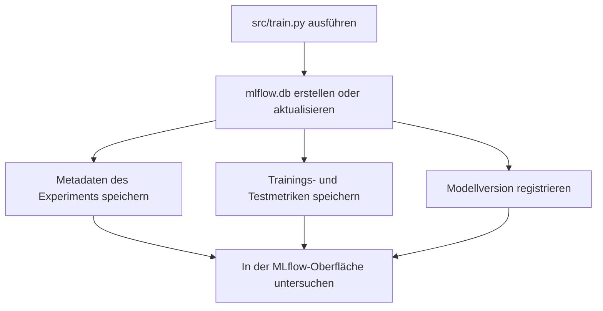

# Modell-Tracking mit MLflow

MLflow hält fest, was während eines Trainings-Runs passiert ist: Parameter, Metriken, Tags und Modellartefakte. In diesem Repository läuft MLflow lokal mit einer SQLite-Datenbank, sodass du das Modell-Tracking untersuchen kannst, ohne einen externen Service einzurichten.

## Lokaler Tracking-Workflow



## Trainingsjob mit Tracking ausführen

Falls du das nicht schon in Schritt `03` gemacht hast, setz die Tracking-URI von MLflow auf eine lokale SQLite-Datenbank und führ dann das Trainingsskript aus:

```bash
export MLFLOW_TRACKING_URI="sqlite:///mlflow.db"
uv run python src/train.py --cml-run
```

Der Befehl trainiert das Modell, schreibt `metrics.txt` und speichert den MLflow-Run in `mlflow.db`.

## MLflow-Oberfläche öffnen

Starte die lokale Oberfläche:

```bash
uv run mlflow ui --backend-store-uri sqlite:///mlflow.db
```

Öffne die URL, die MLflow ausgibt, meist <http://127.0.0.1:5000>.

Wenn Port `5000` schon belegt ist, wähl einen anderen lokalen Port:

```bash
uv run mlflow ui --backend-store-uri sqlite:///mlflow.db --port 5001
```

Untersuche in der Oberfläche:

- das Experiment `green-taxi-trip-duration-xgb`,
- den neuesten Run,
- die Metriken `rmse_train`, `rmse_test` und `rows_after_filtering`,
- die Run-Tags, die den Datensatz, die Zielvariable und das Feature-Set beschreiben,
- das registrierte Modell namens `green-taxi-trip-duration-xgb`.

## Worauf du achten solltest

| Signal | Unauffälliges Ergebnis | Mögliches Problem |
| --- | --- | --- |
| `rmse_train` und `rmse_test` | Die Werte liegen nah beieinander. | Der Testfehler ist viel höher, was auf Overfitting hindeutet. |
| `rows_after_filtering` | Entspricht der erwarteten Zeilenzahl nach dem Filtern für den genutzten Datensatz und die genutzten Filter. | Datendatei, Filter oder Eingabemonat haben sich möglicherweise geändert. |
| Modellversion | Nach jedem Run mit Tracking erscheint eine neue Version. | Die MLflow-Registry hat das protokollierte Modell nicht erhalten. |
| Tags | Informationen zu Datensatz, Zielvariable und Features sind vorhanden. | Der Run ist beim Review schwerer zu interpretieren. |

## Zwei Runs vergleichen

Ändere eine kleine Trainingseinstellung, zum Beispiel `n_estimators`, öffne dann ein neues Terminal und führ das Trainingsskript erneut aus:

```bash
export MLFLOW_TRACKING_URI="sqlite:///mlflow.db"
uv run python src/train.py --cml-run
```

Aktualisiere die MLflow-Oberfläche und vergleich die beiden neuesten Runs. Es geht nicht darum, sofort der besten Metrik hinterherzujagen, sondern zu üben, eine Codeänderung mit einem nachverfolgten Ergebnis zu verbinden.

Wenn du fertig bist, kannst du die Oberfläche im laufenden Terminal mit `Ctrl + C` stoppen.

## Erzeugte Dateien

MLflow erstellt lokale Artefakte, die außerhalb von Git bleiben sollten:

| Pfad | Zweck |
| --- | --- |
| `mlflow.db` | SQLite-Datenbank für das lokale Experiment-Tracking und die Metadaten der Model Registry. |
| `mlflow.db-shm` und `mlflow.db-wal` | SQLite-Hilfsdateien, die erscheinen können, solange die Datenbank aktiv ist. |
| `mlruns/` | Lokales dateibasiertes Artefaktverzeichnis, das MLflow für die Artefakte der Runs nutzt. |
| `mlartifacts/` | Lokales Verzeichnis für das Serving der Artefakte, das bei der Nutzung der MLflow-Oberfläche erscheinen kann. |
| `metrics.txt` | Kurzer, für CML vorbereiteter Metrik-Report, den `--cml-run` erzeugt. |

Diese Dateien werden ignoriert, weil sie erzeugte Ausgaben sind. Nimm Code, Workflow-Dateien und Dokumentation in Commits auf, aber keine lokalen Tracking-Datenbanken.
