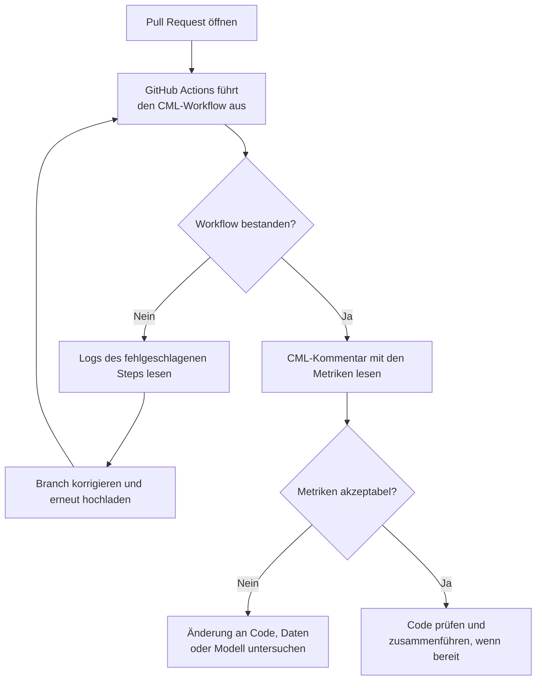
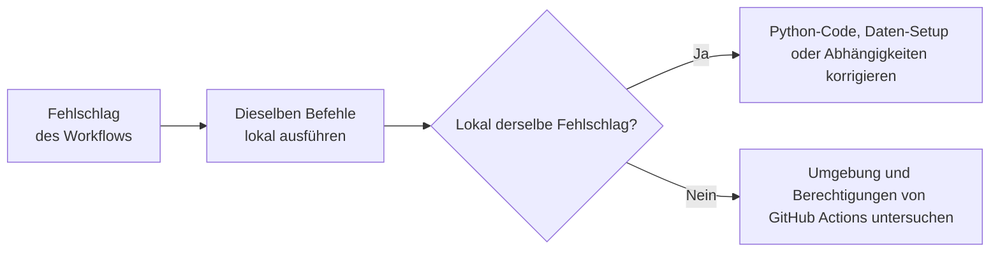

# CI-Review und Fehlerbehebung

Ein CI-Workflow ist nur nützlich, wenn alle, die den Pull Request prüfen, den Workflow lesen können. Diese Lektion konzentriert sich auf den Review-Schritt: einen Pull Request untersuchen, einen CML-Kommentar mit den Metriken verstehen und häufige Fehlschläge beheben, ohne zu raten.

Nutz diese Lektion, nachdem du in Schritt `03` einen Pull Request geöffnet hast, der den CML-Workflow ausführt.

## Review-Workflow



## Mit dem Pull Request beginnen

Prüf im Pull Request diese Bereiche der Reihe nach:

1. **Conversation**: Such den CML-Kommentar mit den Metriken.
2. **Checks**: Prüf, ob der CML-Workflow bestanden hat.
3. **Files changed**: Ordne Änderungen der Metriken den Änderungen an Code, Workflow oder Dokumentation zu.
4. **Commits**: Prüf, ob Korrekturen als neue Commits hinzugefügt wurden, statt den Kontext während des Reviews umzuschreiben.

Diese Reihenfolge hält das Review auf festem Boden: Prüf zuerst das Ergebnis der Automatisierung und untersuche dann den Diff, der es erzeugt hat.

## CML-Kommentar lesen

Der erwartete Report ist kurz:

```text
# Training Metrics

- RMSE on the train set: 4.6850
- RMSE on the test set: 5.0074
- Rows after filtering: 46307
```

Nutz den Kommentar als Signal für das Review:

| Frage | Warum das wichtig ist |
| --- | --- |
| Ist der Workflow durchgelaufen? | Ein fehlender CML-Kommentar bedeutet meist, dass der Workflow vor dem Report fehlgeschlagen ist. |
| Liegen Trainings- und Test-RMSE nah beieinander? | Ein großer Abstand kann auf Overfitting oder ein Problem bei der Datenaufteilung hinweisen. |
| Hat sich die Zeilenzahl geändert? | Eine geänderte Zahl kann eine Änderung an der URL der Daten, am Filtern oder an der Vorverarbeitung aufdecken. |
| Passt die Änderung der Metrik zum Diff? | Eine Änderung am Modellcode sollte eine Veränderung der Metrik erklären. Eine Änderung nur an der Dokumentation sollte das nicht. |

## Häufige Fehlschläge beheben

| Symptom | Wo du zuerst nachsehen solltest | Wahrscheinliche Lösung |
| --- | --- | --- |
| Download der Daten schlägt fehl | Step `Download taxi data` | URL prüfen und den Workflow erneut ausführen. |
| Installation der Abhängigkeiten schlägt fehl | Step `Install dependencies` | `uv lock` ausführen, wenn `uv.lock` nicht mehr zu `pyproject.toml` passt, oder prüfen, ob das Paket Python 3.13 unterstützt. |
| Training schlägt wegen fehlender Daten fehl | Step `Train model` | Prüfen, ob der Workflow die Parquet-Datei herunterlädt, bevor er `src/train.py` ausführt. |
| CML kommentiert nicht | Step `Publish CML report` | `REPO_TOKEN` und die `permissions` des Workflows prüfen. |
| Metriken sehen unerwartet anders aus | CML-Kommentar und Diff von `src/train.py` | Vorverarbeitung, Features, Modelleinstellungen und Monat der Daten prüfen. |

## Lokale Reproduktion



Wenn ein Workflow fehlschlägt, reproduziere dieselben Kernschritte lokal, bevor du den Workflow änderst:

```bash
uv sync
mkdir -p data
curl -L --fail -o data/green_tripdata_2025-01.parquet \
  https://d37ci6vzurychx.cloudfront.net/trip-data/green_tripdata_2025-01.parquet
export MLFLOW_TRACKING_URI="sqlite:///mlflow.db"
uv run python src/train.py --cml-run
cat metrics.txt
```

Wenn der lokale Befehl auf dieselbe Weise fehlschlägt, korrigiere zuerst den Python-Code oder das Setup der Abhängigkeiten. Wenn der lokale Befehl funktioniert, GitHub Actions aber fehlschlägt, untersuche die Umgebung, die Berechtigungen und die Shell-Befehle des Workflows.

## Über den Merge entscheiden

Ein bestandener Workflow ist nicht dasselbe wie eine gute Änderung. Nutz diese Entscheidungstabelle:

| Situation | Entscheidung im Review |
| --- | --- |
| Workflow schlägt fehl | Nicht zusammenführen. Logs lesen und den Branch korrigieren. |
| Workflow besteht und Metriken sind stabil | Mit dem normalen Code-Review weitermachen. |
| Workflow besteht, aber der Test-RMSE steigt | Fragen, ob die Änderung die Veränderung der Metrik erklärt. |
| Workflow besteht, aber die Zeilenzahl ändert sich | Prüfen, ob die Änderung an Datenquelle oder Filter beabsichtigt war. |
| PR nur mit Änderungen an der Dokumentation ändert Metriken | Untersuchen. Änderungen an der Dokumentation sollten das Training nicht verändern. |
