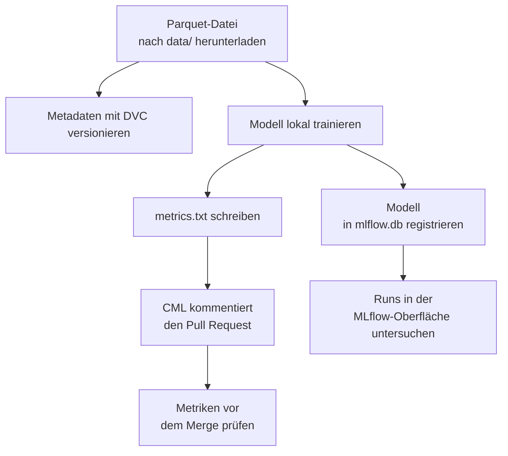

# GitHub Actions und CI/CD für Machine Learning

Dieses Repository zeigt, wie GitHub Actions, DVC und CML in einen kleinen CI/CD-Workflow für Machine Learning passen. Das Ziel ist, dass du von einem einfachen Test für Pull Requests zu einem reproduzierbaren ML-Workflow kommst, der Daten mit DVC versioniert, ein Modell trainiert und Metriken in einem Pull Request veröffentlicht.

## Lernziele

Am Ende dieses Repositorys kannst du:

- einen Workflow mit GitHub Actions erstellen, der bei Pull Requests läuft.
- `main` mit Vorgaben für Reviews und Status-Checks schützen.
- DVC-Metadaten nutzen, um einen großen ML-Datensatz zu versionieren, ohne die Datendatei in einen Commit aufzunehmen.
- DVC mit einem lokalen Remote-Verzeichnis verbinden.
- einen CML-Workflow ausführen, der ein Modell trainiert und Metriken als Kommentar im Pull Request veröffentlicht.
- lokale MLflow-Runs, Metriken, Tags und registrierte Modellversionen untersuchen.
- Fehler in fehlgeschlagenen CI-Runs beheben und entscheiden, ob Änderungen der Metriken bereit für den Merge sind.

## Lernpfad

| Datei / Ordner | Beschreibung |
| --- | --- |
| [**01 - Einführung in GitHub Actions**](01-intro-github-actions.md) | Einen Workflow für Pull Requests erstellen, Tests ausführen und `main` schützen. |
| [**02 - Einführung in DVC**](02-intro-to-dvc.md) | Eine Green-Taxi-Parquet-Datei mit DVC versionieren und in ein lokales DVC-Remote hochladen. |
| [**03 - CI/CD-Workflow mit CML**](03-cicd-workflow-with-cml.md) | Daten in GitHub Actions herunterladen, das Modell trainieren und Metriken mit CML veröffentlichen. |
| [**04 - Modell-Tracking mit MLflow**](04-mlflow-model-tracking.md) | Lokale MLflow-Experimente, Metriken, Tags und registrierte Modellversionen untersuchen. |
| [**05 - CI-Review und Fehlerbehebung**](05-ci-review-and-troubleshooting.md) | CI-Logs lesen, CML-Kommentare interpretieren und entscheiden, ob eine Modelländerung bereit für den Merge ist. |

### Weitere Ordner und Dateien

| Datei / Ordner | Beschreibung |
| --- | --- |
| [**src/train.py**](src/train.py) | Skript, das das XGBoost-Modell trainiert, es in MLflow protokolliert und `metrics.txt` schreibt. |
| [**.github/workflows/cml.yaml**](.github/workflows/cml.yaml) | Workflow in GitHub Actions, der das Modell trainiert und Metriken als Kommentar in Pull Requests veröffentlicht. |
| [**data**](data/) | Lokaler Ordner für die Green-Taxi-Parquet-Datei. |
| [**assets**](assets/) | Abbildungen, auf die das Repository verweist. |
| [**pyproject.toml**](pyproject.toml) | Projektkonfiguration und Abhängigkeiten. |
| [**uv.lock**](uv.lock) | Lock-Datei für die Abhängigkeiten. |

## Alles lokal

Dieses Repository ist dafür ausgelegt, lokal zu laufen. Der Hauptpfad braucht nur:

- die Python-3.13-Umgebung, die `uv sync` erstellt,
- die Green-Taxi-Parquet-Datei von Januar 2025, heruntergeladen nach `data/`,
- einen lokalen MLflow-Store auf Basis von SQLite,
- ein optionales lokales DVC-Remote-Verzeichnis, wenn du DVC übst.



## Voraussetzungen

- Unter macOS braucht XGBoost die **OpenMP**-Laufzeitbibliothek. Installiere sie mit Homebrew, bevor du das Trainingsskript ausführst:

  ```bash
  brew install libomp
  ```

> [!NOTE]
> **Unter Windows:** Die Befehle in diesem Repository nutzen Bash-Syntax. Führ sie mit **Git Bash** aus (installiert mit [Git for Windows](https://git-scm.com/downloads/win)), nicht mit PowerShell.

## Setup

Verwende [uv](https://docs.astral.sh/uv/getting-started/installation/) 0.13.5 oder neuer
und Python 3.13.17 oder ein neueres Patch-Release von 3.13, wie in
[`.python-version`](.python-version) festgelegt.

> [!NOTE]
> In allen Schritten ist Text in spitzen Klammern wie `<repo-name>` ein
> **Platzhalter**. Ersetze ihn samt den Klammern `< >` durch deinen eigenen
> Wert. Aus `cd <repo-name>` wird zum Beispiel `cd mle-github-actions-and-cicd`.

### 1. Repository aus dem Template erstellen

Klick auf GitHub auf **Use this template**.

Beim Erstellen des Repositorys:

- Leg dich selbst als **Owner** fest
- Wähl einen Namen für das Repository
- Deaktiviere **Include all branches**
- Klick auf **Create repository**

> [!IMPORTANT]
> Wenn du zu zweit oder in einer Gruppe arbeitest, erledigt nur **eine Person** diesen Schritt.

---

### 2. Collaborators hinzufügen (nur bei Paar- oder Gruppenarbeit)

Wenn du mit Teammitgliedern arbeitest:

1. Öffne das Repository auf GitHub
2. Geh zu **Settings → Collaborators**
3. Füg deine Teammitglieder als Collaborators hinzu
4. Teil den Link zum Repository mit deinem Team

Die Teammitglieder sollten die Einladung annehmen, bevor sie weitermachen.

---

### 3. Repository klonen

Kopier die SSH-URL über den Button **Code** auf GitHub und führ dann Folgendes aus:

```bash
git clone <copied-ssh-url>
```

Die kopierte SSH-URL hat die Form `git@github.com:<your-username>/<repo-name>.git`.

---

### 4. In den Projektordner wechseln und Abhängigkeiten installieren

Das installiert alle Abhängigkeiten und erstellt eine virtuelle Umgebung in `.venv/`.

```bash
cd <repo-name>
uv sync
```

---

### 5. Repository in VS Code öffnen

> [!NOTE]
> Achte darauf, VS Code im Stammverzeichnis des Projekts zu öffnen, damit es die von `uv sync` erstellte Umgebung automatisch erkennt.

Starte VS Code im Stammverzeichnis des Projekts:

```bash
code .
```

Jeder Befehl in der Anleitung läuft über `uv run`, deshalb wird diese Umgebung automatisch genutzt.

## Aufräumen

Um die Ausgaben von Training und MLflow zu entfernen, aber die heruntergeladenen Daten und dein DVC-Setup zu behalten, führ im Stammverzeichnis des Projekts Folgendes aus:

```bash
rm -rf mlruns mlartifacts
rm -f mlflow.db mlflow.db-shm mlflow.db-wal metrics.txt report.md
```

Um das Repository vollständig zurückzusetzen, entfern auch die Daten, die DVC-Dateien und das lokale DVC-Remote:

```bash
rm -rf data .dvc .dvcignore ../dvc-local-remote
mkdir data
touch data/.gitkeep
```

Wenn du die DVC-Dateien in Lektion 2 in einen Commit aufgenommen hast, nimm ihre Entfernung in einen Commit auf, bevor du neu beginnst:

```bash
git add .dvc .dvcignore data
git commit -m "Reset DVC exercise"
```

> [!CAUTION]
> Diese Befehle löschen deine lokalen MLflow-Runs, die registrierten Modellversionen und das DVC-Remote endgültig. Führ sie nur im Stammverzeichnis des Projekts aus.

## Quellen & weiterführende Literatur

- [**GitHub Actions Docs**](https://docs.github.com/en/actions): Offizieller Leitfaden zu Workflows, Jobs und Runnern.
- [**Using uv in GitHub Actions**](https://docs.astral.sh/uv/guides/integration/github/): Wie der Workflow die Abhängigkeiten mit `setup-uv` installiert.
- [**About Protected Branches**](https://docs.github.com/en/repositories/configuring-branches-and-merges-in-your-repository/managing-protected-branches/about-protected-branches): Wie Branch-Schutzregeln und erforderliche Status-Checks funktionieren.
- [**DVC Docs**](https://dvc.org/doc): Datenversionierung, Remotes und Pipelines.
- [**CML Docs**](https://cml.dev/doc): ML-Ergebnisse als Report in Pull Requests veröffentlichen.
